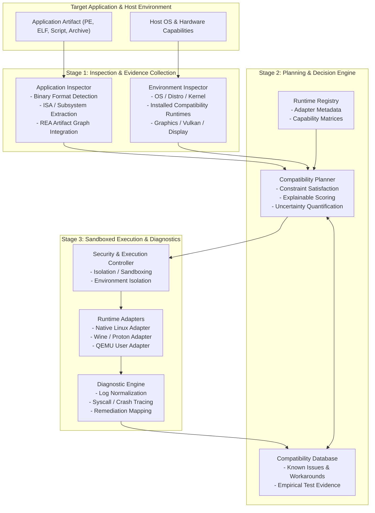

# ZCF System Architecture Specification

**Project:** Zyntrix Compatibility Fabric (ZCF)  
**Document:** `docs/ARCHITECTURE.md`  
**Date:** October 24, 2026  
**Status:** Approved Initial Architecture  

---

## 1. Architectural Philosophy and Mission

The Zyntrix Compatibility Fabric (ZCF) is a distribution-independent, open-source application compatibility platform, runtime orchestration system, and compatibility research infrastructure.

ZCF does not attempt to reimplement operating system kernels or universal emulators from scratch. Instead, it serves as the **intelligent coordination and diagnostic fabric** across existing runtime engines (Wine, Proton, QEMU, Box64, FEX), binary analysis tools (REA, readelf, objdump), and a shared, evidence-backed knowledge repository.

---

## 2. High-Level System Architecture



---

## 3. Subsystem Breakdown and Contracts

### 3.1 Application Inspector (`src/inspector/`)
- **Purpose:** Parse and extract metadata from application binaries without executing them.
- **Supported Formats:**
  - **Windows PE / COFF:** Identifies PE32/PE32+, Machine ISA (`x86_64`, `i386`, `ARM64`), Subsystem (`GUI`, `Console`, `Native`), DLL imports (`KERNEL32`, `USER32`, `D3D11`, `VULKAN-1`), and .NET CLI metadata flags.
  - **Linux ELF:** Identifies ELF32/ELF64, Machine ISA, ABI type, dynamic interpreter (`PT_INTERP`), and linked libraries (`DT_NEEDED`).
  - **Shell Scripts & Interpreted Packages:** Identifies shebang lines (`#!/usr/bin/env python3`, `#!/bin/bash`).
- **Safety Boundary:** Never executes the target binary. Employs byte-level validation and delegates deep structural graphing to REA's safe artifact graph provider.

### 3.2 Environment Inspector (`src/environment/`)
- **Purpose:** Audit the host system's capabilities, architecture, and installed compatibility software.
- **Audited Metrics:**
  - Host OS distribution, release codename, and kernel version.
  - Host CPU ISA, core count, and address bounds.
  - Memory capacity and disk storage.
  - Display server availability (X11, Wayland, or Headless).
  - Graphics capabilities (Vulkan API, OpenGL version).
  - Discovered runtime runtimes: `wine64`, `wine`, `qemu-aarch64`, `qemu-arm`, `box64`, `fex`.
  - Binary analysis tools: `rea`, `strace`, `readelf`, `objdump`, `patchelf`.

### 3.3 Runtime Registry (`src/runtimes/registry.py`)
- **Purpose:** Central catalog of all registered runtime adapters.
- **Contract:** Each entry defines:
  - `runtime_id`: Unique identifier (e.g., `runtime.native`, `runtime.wine`, `runtime.qemu-user`).
  - `name`: Display name.
  - `supported_formats`: Formats handled (`pe`, `elf`, `script`).
  - `supported_architectures`: ISAs supported.
  - `status`: Availability (`available`, `not_installed`, `unsupported_host`).
  - `adapter_class`: Implementation of `RuntimeAdapterInterface`.

### 3.4 Compatibility Planner (`src/planner/`)
- **Purpose:** Multi-criteria rule-based decision engine matching an `ApplicationDescription` against an `EnvironmentReport`.
- **Decision Workflow:**
  1. **ISA Matching:** Compares application ISA with host ISA. If mismatched, disqualifies native execution and seeks architecture translation (QEMU, Box64).
  2. **OS Semantics Matching:** Windows PE binaries require Wine or Proton; Linux ELF binaries use Native or QEMU.
  3. **Dependency and Capability Verification:** Checks graphics, display server, and library prerequisites.
  4. **Scoring & Uncertainty:** Generates a deterministic confidence score (0.0 to 1.0) with plain-language explanations of selected, rejected, and missing requirements.

### 3.5 Runtime Adapter Interface (`src/runtimes/base.py`)
- **Contract:**
  ```python
  class RuntimeAdapterInterface(ABC):
      @abstractmethod
      def get_id(self) -> str: ...
      @abstractmethod
      def is_available(self, env: EnvironmentReport) -> bool: ...
      @abstractmethod
      def validate(self, app: ApplicationDescription, env: EnvironmentReport) -> ValidationResult: ...
      @abstractmethod
      def prepare_environment(self, app: ApplicationDescription, config: ExecutionConfig) -> PreparedContext: ...
      @abstractmethod
      def execute(self, app: ApplicationDescription, context: PreparedContext) -> ExecutionResult: ...
  ```

### 3.6 Compatibility Database (`src/compatibility_db/`)
- **Purpose:** Versioned, machine-readable repository of tested compatibility profiles and workarounds.
- **Format:** Strict JSON documents validated against `schemas/compatibility_entry.schema.json`.
- **Entries Record:** Application SHA-256, target OS, tested host environment, runtime versions, required overrides (e.g., `d3d11=native`), observed outcomes, and confidence ratings.

### 3.7 Diagnostic Engine (`src/diagnostics/`)
- **Purpose:** Parse runtime execution logs, classify failure signatures, and correlate errors with actionable remediation advice.
- **Signature Patterns:**
  - `missing_shared_library`: Detects `error while loading shared libraries` or `Failed to load module`.
  - `unsupported_syscall`: Intercepts unhandled Linux/QEMU syscall signals.
  - `wine_page_fault`: Classifies NT access violations and SEH exceptions.
  - `missing_display`: Detects failures to connect to X11/Wayland display.

### 3.8 Security & Execution Controller (`src/security/`)
- **Purpose:** Enforce least-privilege execution and sandboxing.
- **Rules:**
  - Applications run as non-root users.
  - File access is scoped to isolated temporary prefix directories.
  - Execution bounds (timeouts, memory limits) prevent denial of service.
