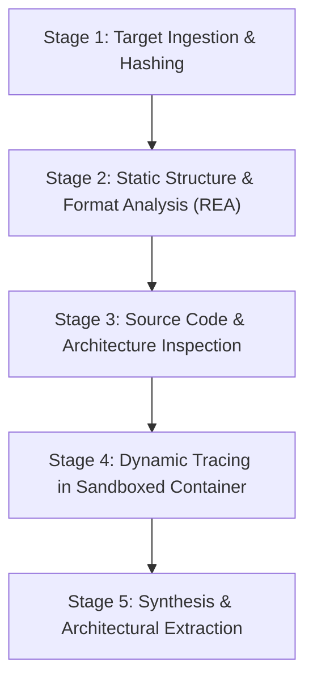

# ZCF Reverse Engineering and Research Methodology

**Project:** Zyntrix Compatibility Fabric (ZCF)  
**Document:** `docs/RESEARCH_METHOD.md`  
**Date:** October 24, 2026  
**Standards:** Evidence-Backed Verification, Authority Tiers, Least-Privilege Static Inspection

---

## 1. Principles of Compatibility Research

ZCF establishes an evidence-based research methodology to study software execution behavior, understand third-party compatibility technologies, identify failure modes, and engineer robust, reproducible fixes.

Our methodology adheres to five core axioms:
1. **Never Assume Ground Truth from Speculation:** Decompilations, reconstructed pseudocode, and AI hypotheses are probabilistic models, not original source code.
2. **Authority Tiers and Provenance:** Every claim must carry a provenance tag and confidence rating:
   - `shipped-artifact`: Exact binary bytes, cryptographic hashes, and PE/ELF headers.
   - `static-observation`: Directly parsed structures, symbol tables, and declared imports/exports.
   - `dynamic-trace`: Observed system calls, IPC messages, and execution traces.
   - `hypothesis`: Inferred explanations requiring empirical validation.
3. **Least-Privilege Static Analysis First:** Unknown or third-party binaries must never be executed blindly to see what happens. Static analysis with REA and dedicated inspectors must precede any controlled dynamic execution.
4. **Reproducible Test Boundaries:** Failure conditions must be distilled into minimal test fixtures or mock environments.
5. **Open-Source Licensing and Clean-Room Integrity:** Research informs architecture, API contracts, and adapter specifications. Upstream source code must never be copied into ZCF in violation of open-source licenses.

---

## 2. Five-Stage Investigation Workflow

### Stage 1: Target Ingestion and Integrity Verification
- Compute cryptographic digests (`SHA-256`, `BLAKE3`).
- Record file size, media type, and source provenance.
- Store immutable target metadata in the research registry.

### Stage 2: Static Structure and Format Analysis
- Use REA's safe artifact graph provider (`inspect_artifact`) to build the content-addressed tree.
- Extract binary headers:
  - Windows PE: Machine architecture, subsystem (GUI vs Console), entry point, DLL import table, export table, data directories, TLS callbacks, .NET CLI metadata directory.
  - Linux ELF: e_machine, e_type (EXEC vs DYN/PIE), interpreter (`PT_INTERP`), program headers, dynamic section (`DT_NEEDED`, `DT_RPATH`, `DT_RUNPATH`).
- Identify unresolved symbols and declared dependencies.

### Stage 3: Source Code and Architecture Inspection
- When analyzing open-source compatibility runtimes (Wine, Proton, Box64, QEMU), check out the official source repository.
- Frame narrow, falsifiable research questions (e.g., "How does Wineserver coordinate handle inheritance across POSIX fork/exec boundaries?").
- Trace execution flow from entry points to OS boundary calls using static source search and cross-referencing.

### Stage 4: Controlled Dynamic Tracing
- Execute targets only in isolated test environments (non-root Linux namespace or disposable prefix).
- Collect execution signals:
  - Linux: `strace -f -e trace=file,process,network,ipc -o trace.log <command>`
  - Wine: `WINEDEBUG=+relay,+module,+file wine <target>`
- Normalize log messages into structured diagnostic events with timestamps, PID/TID, syscall names, arguments, and return codes.

### Stage 5: Synthesis and Knowledge Codification
- Identify the root cause of any observed failure (e.g., missing syscall emulation, ABI divergence, missing library dependency, unhandled registry key).
- Document findings in a structured Research Report (`research/<topic>.md`).
- Codify reproducible knowledge into the ZCF Compatibility Database (`schemas/compatibility_entry.schema.json`).

---

## 3. Integration with REA (Reverse Engineer Anything)

REA serves as ZCF's primary reverse-engineering instrument:
1. **Automated Artifact Profiling:** REA's MCP tools (`open_binary`, `inspect_artifact`, `inspect_managed_artifact`) generate typed Evidence JSON without executing target code.
2. **Next Probes Guidance:** REA reports unexplored branches and recommends subsequent investigative operations (e.g. `inspect_managed_members`, `open_binary`).
3. **Decompilation and Disassembly:** When native engines (Ghidra, Rizin) are configured, REA provides targeted pseudo-code decompilation of identified bottleneck functions.
